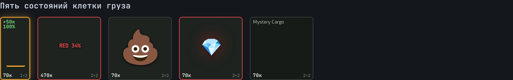
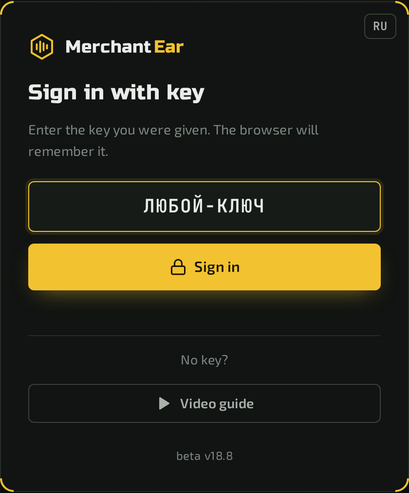
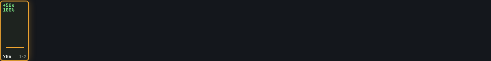
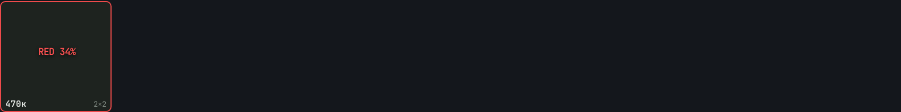
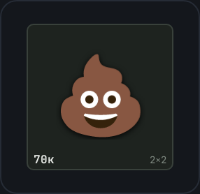
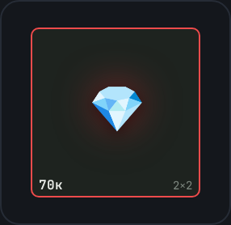
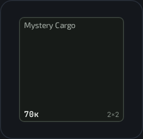
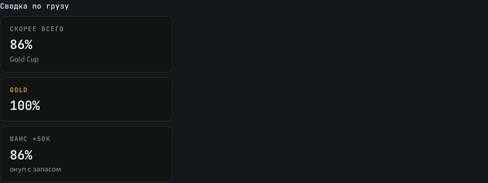
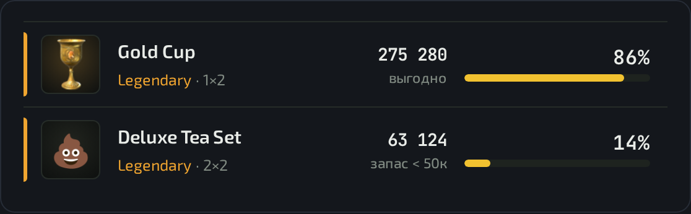
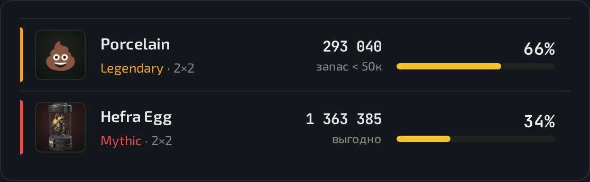

# 🎧 Merchant Ear

**Узнавай, что лежит в грузе торговца, — по звуку**

**Ничего качать и ставить не нужно — нажал кнопку и работаешь.** 🕹️
Бесплатно, без регистрации и без пробного режима.

Прилавок торговца: программа отмечает каждый груз — брать или нет

---

## 🎮 Что это такое

В **Arena Breakout: Infinite** полевой торговец продаёт закрытые грузы. Что внутри — неизвестно.
Но когда ты перетаскиваешь груз, игра проигрывает **звук предмета, который лежит внутри** —
всего их 38.

Merchant Ear **слышит этот звук сам**, читает с экрана размер и цену груза, и сразу говорит:

- 🔍 **что внутри** — все предметы с шансами;
- 💰 **окупается ли** — средняя выгода против цены груза;
- 🎯 **брать или нет** — готовый вердикт на каждом грузе.

Считать в голове не нужно вообще. Открыл — и торгуешь.

> 🆚 Обычные сайты по звуку требуют узнать звук на слух, ввести размер и цену руками и выдают
> просто список всех предметов. Здесь всё считается само.

---

## 🚀 Как пользоваться

**1.** Открой сайт по кнопке выше.

**2.** Введи **любой ключ** — подойдёт любая непустая строка. 🔑

**3.** Нажми **«Слушать»** — откроется окно **выбора карты и режима** 🗺️
(от карты и режима зависят шансы, поэтому шаг обязательный).

**4.** После выбора карты браузер спросит, что показывать:
выбери **«Весь экран»** 🖥️ и поставь галочку **«Поделиться системным звуком»** 🔊

> ℹ️ Демонстрация всего экрана — самый простой и надёжный вариант. Ничего в игре переключать
> не нужно, никаких особых настроек не требуется.

**5.** Открой торговца и **медленно прокрути список до конца** — программа сама построит
карту прилавка 🗺️

**6.** **Наведи курсор на груз** — так читается цена 💵
(в игре цена видна только во всплывающей подсказке).

**7.** **Перетащи груз и отпусти** — прозвучит звук, и ты сразу увидишь, что внутри. 🎧

> 💡 Перетаскивай груз **в свободное место прилавка, а не на соседний товар** —
> так звук точно привяжется к нужному грузу.

---

## 🎨 Что значат значки

| | Что это значит | Что делать |
|:---:|---|---|
|  | ✅ **Выгодно.** Иконка самого вероятного выгодного предмета. Цифра **«+50к NN%»** — шанс отбить груз с запасом от 50 000 | **Брать** 🟢 |
|  | 🔴 **Красный предмет.** Шанс краснухи от 2 %, цифра мигает | Рискнуть 🎲 |
|  | 💩 **Не выгодно** — запас меньше 50 000 | Пропустить ⛔ |
|  | 💎 **Точно красный**, шанс 100 % | Брать, не думая 🏆 |
|  | ⏳ Звук ещё не слышали | Перетащить груз |

**📘 Как считать «выгодно»:** средняя цена того, что выпадет, минус цена груза ≥ **50 000**.
Порог один для всех случаев. Учитываются **все** предметы груза, включая скрытые фиолетовые —
они не показываются, но в расчёте участвуют.

**🔍 Цена** читается только при наведении курсора — из всплывающей подсказки самой игры.

---

## 📊 Что где на экране

<table>
<tr>
<td align="center" width="50%">

**Сводка по грузу** — слева

Скорее всего · GOLD · RED · **Шанс +50к**

</td>
<td align="center" width="50%">

**Список предметов** — цена и шанс

У каждого — **выгодно** или 💩

</td>
</tr>
</table>

 
Груз с краснухой: дорогой ящик, где основной исход не окупается, а красный выпадает в 34 %

---

## ⚖️ Чем лучше обычных определителей

| | 😴 Обычный сайт | 🎧 Merchant Ear |
|---|---|---|
| Звук | узнаёшь на слух, кликаешь кнопку | **слышит сам** |
| Размер и цена | вводишь руками | **читает с экрана** |
| Выдача | список всех предметов | **только выгодное + вердикт** |
| Окупаемость | считаешь в голове | **посчитана** |
| Начало работы | ручной ввод каждого груза | **открыл и работаешь** |

---

## ❓ Частые вопросы

<b>💵 Почему цена не показывается?</b>

Цена груза видна в игре только во всплывающей подсказке. Наведи курсор на груз и подержи
полсекунды — цена появится внизу клетки.

<b>💩 Стояла какашка, а выпало дорогое — почему?</b>

💩 означает «в среднем не окупается», а не «гарантированный мусор». Иногда везёт — но на дистанции
такой груз убыточен.

<b>🖥️ Игра в полном экране — сработает?</b>

Да. Выбирай в диалоге захвата **«Весь экран»** — программа увидит игру в любом режиме.

<b>🛡️ Это чит? Забанят?</b>

По методу — нет: программа не читает память и файлы игры, не внедряется в процесс, а только
слушает звук и смотрит картинку — как OBS или Discord. Но решение принимаешь ты: в правилах игры
есть пункты про сторонние программы.

<b>🔐 Куда уходят мои данные?</b>

Никуда. Все расчёты идут в твоём браузере, сервер не нужен вообще.

---

<b>📦 Хочу себе: запуск локально и свой GitHub Pages</b>

Весь код уже здесь — качать отдельно ничего не нужно: **Code → Download ZIP**.

**Локально:** открой `index.html` двойным кликом. Ключ — любая непустая строка.
Сервер не нужен.

---

🖥️ Windows 10/11 · 🌐 Chrome или Edge · 🎧 захват экрана с системным звуком

Сборка <b>beta v18.8</b> — статическая: работает и локально, и на GitHub Pages, сервер не нужен. 
Данные торговца, цены и иконки — из датамайна игры; звуки и иконки принадлежат правообладателям.

