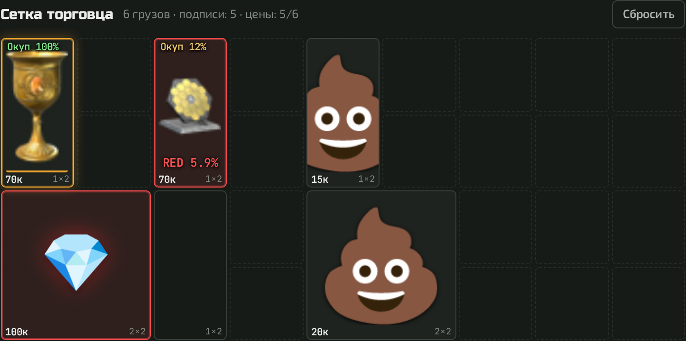
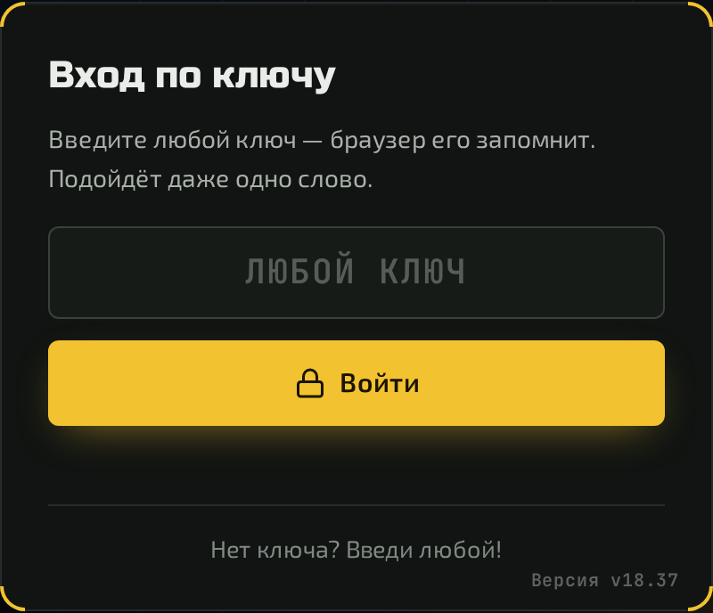
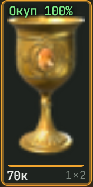
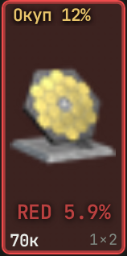
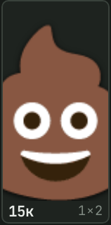
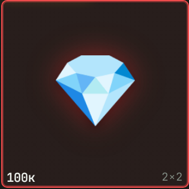
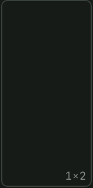
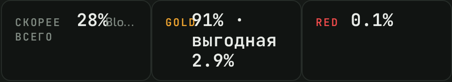
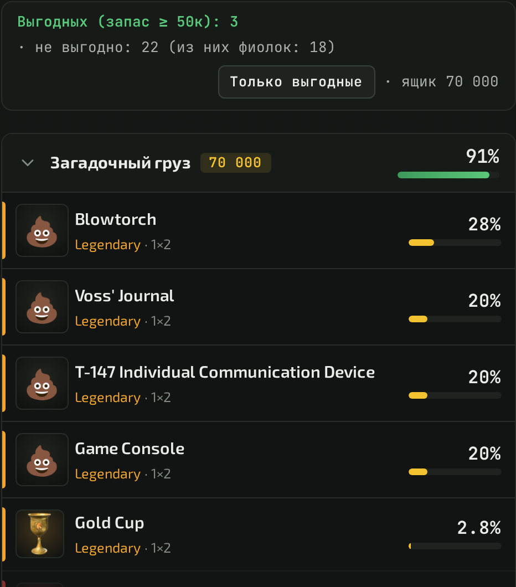
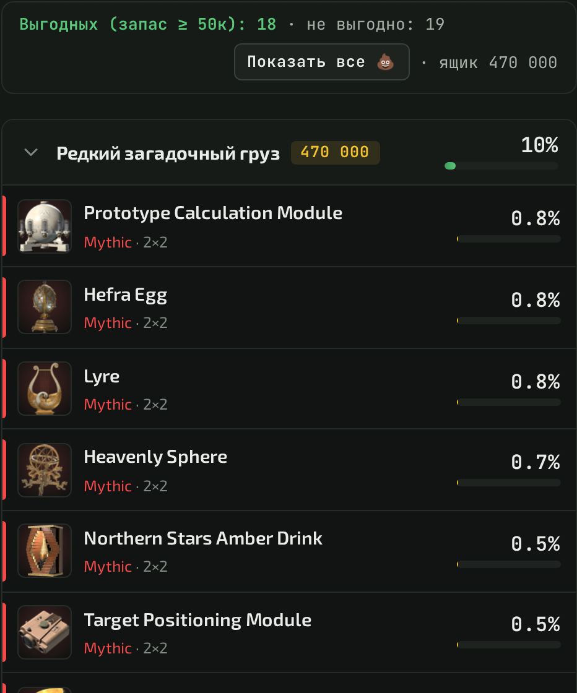

# 🎧 ABI Merchant Unlimited

**Груз торговца: слышит звук, читает размер и цену — и сразу говорит, брать или нет**

**Ничего качать и ставить не нужно — нажал кнопку и работаешь.** 🕹️
Бесплатно, без регистрации и без пробного режима.

Прилавок торговца: программа отмечает каждый груз — брать или нет

---

## 🎮 Что это такое

В **Arena Breakout: Infinite** полевой торговец продаёт закрытые грузы. Что внутри — неизвестно.
ABI Merchant Unlimited разбирает каждый груз **по трём признакам сразу** и сам сводит их в ответ:

| | Что берём | Откуда |
|:---:|---|---|
| 🎧 | **Звук** предмета внутри — всего их 38 | слышит сам |
| 📐 | **Размер** груза | читает с экрана |
| 💵 | **Цену** груза | читает из всплывающей подсказки игры |
| 🗺️ | **Карту и режим** | ты выбираешь один раз |
| 🧮 | **Шансы и окупаемость** | считает по таблицам торговца |

**Всё это совмещается автоматически.** От тебя — два движения: навести курсор на груз
и перетащить его. Ни звук на слух определять, ни цену вбивать руками не нужно.

А на выходе — не просто список:

- 🔍 **что внутри** — все предметы с шансами;
- 💰 **окупится ли** — средняя выгода против цены груза;
- 🎯 **брать или нет** — готовый вердикт на каждом грузе.

> 🆚 Обычные сайты по звуку требуют узнать звук на слух, ввести размер и цену руками и выдают
> просто список всех предметов. Здесь три признака снимаются сами и сразу дают ответ.

---

## 🚀 Как пользоваться

**1.** Открой сайт по кнопке выше.

**2.** Введи **любой ключ** — подойдёт любая непустая строка. 🔑

**3.** Нажми **«Слушать»** — откроется окно **выбора карты и режима** 🗺️
(от карты и режима зависят шансы, поэтому шаг обязательный).

**4.** После выбора карты браузер спросит, что показывать:
выбери **«Весь экран»** 🖥️ и поставь галочку **«Поделиться системным звуком»** 🔊

> ℹ️ Демонстрация всего экрана — самый простой и надёжный вариант. Ничего в игре переключать
> не нужно, никаких особых настроек не требуется.

**5.** Открой торговца и **медленно прокрути список до конца** — программа сама построит
карту прилавка 🗺️

**6.** **Наведи курсор на груз** — так читается цена 💵
(в игре цена видна только во всплывающей подсказке).

**7.** **Перетащи груз и отпусти** — прозвучит звук, и ты сразу увидишь, что внутри. 🎧

> 💡 Перетаскивай груз **в свободное место прилавка, а не на соседний товар** —
> так звук точно привяжется к нужному грузу.

---

## 🎨 Что значат значки

| | Что это значит | Что делать |
|:---:|---|---|
|  | ✅ **Выгодно.** Иконка самого вероятного выгодного предмета и полоса **«Окуп NN%»** — шанс, что груз окупится с прибылью **от 50 000** | **Брать** 🟢 |
|  | 🔴 **Есть красный.** Груз мат-выгодный **и** внутри может быть красный: иконка выгодного предмета, полоса **«Окуп NN%»** сверху и плашка **«RED NN%»** внизу — всё сразу | Рискнуть 🎲 |
|  | 💩 **Не выгодно** — в среднем не отбивается | Пропустить ⛔ |
|  | 💎 **Точно красный**, шанс 100 % | Брать, не думая 🏆 |
|  | ⏳ **Звук ещё не слышали** — груз не перетаскивали | Перетащить груз |

**📘 Как считается «выгодно»:** берётся средняя цена всего, что может выпасть из груза,
вычитается цена груза — если остаётся **≥ 50 000**, груз выгодный. Порог один для всех случаев.

**🔢 Что такое «Окуп NN%»:** вероятность, что после вскрытия ты окажешься **в плюсе
минимум на 50 000**. Показывается на всех мат-выгодных грузах — и с краснухой тоже:
одно другому не мешает.

**📦 Учитывается всё:** в расчёт идут **все** предметы груза, включая скрытые фиолетовые —
они не показываются, но на шанс и окупаемость влияют.

**🔍 Цена** читается только при наведении курсора — из всплывающей подсказки самой игры.

---

## 📊 Что где на экране

<table>
<tr>
<td align="center" width="50%">

**Сводка по грузу** — слева

Скорее всего · GOLD · RED · **Окуп**

</td>
<td align="center" width="50%">

**Список предметов** — цена и шанс

У каждого — **выгодно** или 💩

</td>
</tr>
</table>

 
Груз с краснухой: дорогой ящик, где основной исход не окупается, а красный выпадает в 34 %

---

## ⚖️ Чем лучше обычных определителей

| | 😴 Обычный сайт | 🎧 ABI Merchant Unlimited |
|---|---|---|
| Звук | узнаёшь на слух, кликаешь кнопку | **слышит сам** |
| Размер и цена | вводишь руками | **читает с экрана** |
| Совмещение признаков | вручную, в своей голове | **автоматически** |
| Выдача | список всех предметов | **только выгодное + вердикт** |
| Окупаемость | считаешь в голове | **посчитана** |
| Начало работы | ручной ввод каждого груза | **открыл и работаешь** |

---

## ❓ Частые вопросы

<b>💵 Почему цена не показывается?</b>

Цена груза видна в игре только во всплывающей подсказке. Наведи курсор на груз и подержи
полсекунды — цена появится внизу клетки.

<b>🔢 Что значит «Окуп NN%»?</b>

Это шанс, что груз окупится с прибылью от 50 000: средняя цена того, что выпадет, минус цена груза
≥ 50 000. Например, «Окуп 100 %» — груз отбивается гарантированно.
Полоса горит зелёным при шансе от 50 % и жёлтым — если ниже.

<b>💩 Стояла какашка, а выпало дорогое — почему?</b>

💩 означает «в среднем не окупается», а не «гарантированный мусор». Иногда везёт — но на дистанции
такой груз убыточен.

<b>🖥️ Игра в полном экране — сработает?</b>

Да. Выбирай в диалоге захвата **«Весь экран»** — программа увидит игру в любом режиме.

<b>🛡️ Это чит? Забанят?</b>

По методу — нет: программа не читает память и файлы игры, не внедряется в процесс, а только
слушает звук и смотрит картинку — как OBS или Discord. Но решение принимаешь ты: в правилах игры
есть пункты про сторонние программы.

<b>🔐 Куда уходят мои данные?</b>

Никуда. Все расчёты идут в твоём браузере, на сайт не отправляется ничего.

---

<b>📦 Хочу себе: запуск локально и свой GitHub Pages</b>

Весь код уже здесь — качать отдельно ничего не нужно: **Code → Download ZIP**.

**Локально:** открой `index.html` двойным кликом. Ключ — любая непустая строка.

**Свой GitHub Pages:** залей содержимое в корень публичного репозитория (чтобы `index.html`
лежал в корне), затем *Settings → Pages → Deploy from a branch → main / (root)*. Через минуту
сайт будет по адресу `https://megafunna.github.io/abiear-free/`
(у себя подставьте свой логин и имя репозитория).

---

🖥️ Windows 10/11 · 🌐 Chrome или Edge · 🎧 захват экрана с системным звуком

Сборка <b>beta v18.8</b> · Данные торговца, цены и иконки — из датамайна игры; звуки
и иконки принадлежат правообладателям.

